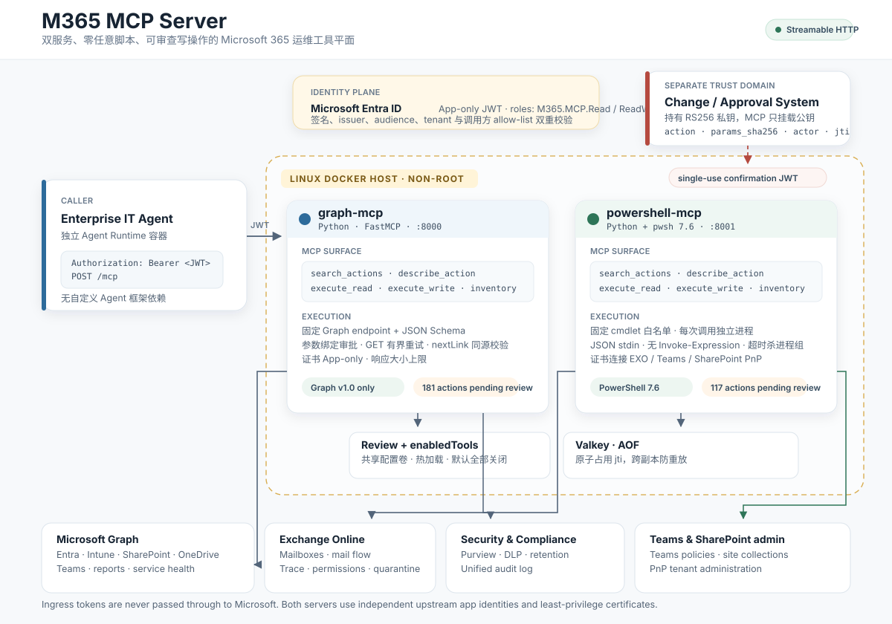

# 架构设计



## 1. 设计目标

本项目为 Enterprise IT Operations Agent 提供一组受治理的 Microsoft 365 运维工具。
两个 MCP Server 独立构建、独立运行、独立配置身份和权限。
Agent Runtime 不进入 MCP 容器，通过 Streamable HTTP 调用。
业务动作以声明式目录管理，不允许调用方提交任意 URL、HTTP method、PowerShell 脚本或 cmdlet。
所有业务动作默认关闭，只有完成 Review 并由管理员加入 `enabledTools` 后才可执行。
写操作在服务端强制校验外部签发的短期、单次、动作和参数绑定的确认令牌。
本文档描述当前实现，不声称已经完成真实 tenant 验收。

## 2. 组件边界

| 组件 | 运行位置 | 职责 | 不负责 |
|---|---|---|---|
| Agent Runtime | 独立容器 | 理解意图、选择动作、提交参数、发起审批、持有 M365 业务上下文 | 不持有 Microsoft Graph 上游证书，不绕过 MCP 策略 |
| graph-mcp | `graph-mcp` 容器 | 校验入口 JWT、搜索目录、校验 Schema、调用固定 Graph endpoint、签发调用回执 | 不执行 PowerShell，不实现任意 Graph proxy |
| powershell-mcp | `powershell-mcp` 容器 | 校验入口 JWT、校验目录、启动一次性 `pwsh`、调用固定 cmdlet | 不接受任意脚本，不复用长期 PowerShell 会话 |
| Valkey | `valkey` 容器 | 原子占用 confirmation `jti`，跨副本防重放 | 不保存审批私钥，不保存业务数据 |
| Review 配置卷 | Linux Host | 保存人工 Review 决策与 `enabledTools`，只读挂载进容器 | 不由容器自行批准，不包含上游凭据 |
| Change / Approval System | 独立信任域 | 校验业务变更、使用 RS256 私钥签发 confirmation JWT | 不直接调用 Microsoft Graph，不持有 M365 应用证书 |
| DGX Spark embedding service | 独立 AI 服务 | 为 search query 和 action text 生成向量 | 不持有 M365 权限，不决定 action 是否 enabled 或可执行 |
| Microsoft Entra ID | Microsoft Cloud | 入口 JWT 签发、MCP 入口 app role、上游 app-only token | 不代替 Agent 完成写操作审批 |

## 3. 两种完全独立的信任链

### 3.1 入口信任链

Agent Runtime 使用自己的 Entra 应用身份获取 app-only JWT。
请求 audience 必须等于对应 MCP Server 的 Application ID URI。
两个 MCP Server 分别校验签名、issuer、audience、tenant、`roles` 和允许的调用方 client ID。
`M365.MCP.Read` 允许调用只读工具。
`M365.MCP.ReadWrite` 允许调用只读和写工具。
入口 token 只用于 MCP 授权，永不转发给 Microsoft Graph 或 PowerShell。
这条链路只回答“谁在调用 MCP”，不回答“是否批准这次变更”。

### 3.2 上游信任链

Graph MCP 使用独立的 Graph 应用注册和证书。
PowerShell MCP 使用独立的 Exchange Online 应用注册和证书，运行 PowerShell 7.6.9。
证书通过 Docker secret 挂载，私钥不进入镜像和配置文件。
Graph MCP 使用 MSAL certificate client credential 获取 Graph token。
PowerShell MCP 每次调用新建 `pwsh` 进程，由模块自行完成 certificate app-only 登录。
这条链路只回答“MCP 能以什么权限调用 Microsoft 365”，不继承 Agent 的用户身份。

### 3.3 审批信任链

写操作使用第三条独立信任链。
审批系统持有 RS256 私钥并签发 confirmation JWT。
MCP 容器只挂载公钥。
令牌绑定 `aud`、`action`、`params_sha256`、`actor`、`jti` 和 `exp`。
MCP 在调用上游前抢占 `jti`，因此同一个审批不能重放，也不能用于参数稍有变化的动作。
审批系统不可用时，写操作失败关闭。

## 4. MCP 工具面

两个 Server 暴露相同的五个治理工具，业务动作不直接注册为数百个 MCP tool。

| MCP Tool | 用途 | MCP annotations |
|---|---|---|
| `search_actions` | 按意图、domain 和读写类型检索可用动作 | readOnly=true, destructive=false |
| `describe_action` | 返回单动作的完整 Schema、权限、风险、Review 和 enabled 状态 | readOnly=true, destructive=false |
| `execute_read` | 执行已启用的只读动作 | readOnly=true, destructive=false |
| `execute_write` | 校验 confirmation JWT 后执行已启用的写动作 | readOnly=false, destructive=true |
| `get_tool_inventory` | 分页读取目录快照 | readOnly=true, destructive=false |

这种 search + execute 模式避免把 298 个动作的 Schema 每轮注入 Agent 上下文。
每个动作仍有独立 Tool ID、独立描述、独立权限、独立风险和独立 Schema。
`execute_read` 与 `execute_write` 严格分离，不允许一个工具根据 HTTP method 执行读写混合操作。
调用方必须提交固定 action ID，不能提交 endpoint 或 cmdlet。
单个 Server 暴露五个工具。
Agent 同时连接两个 Server 时，MCP Client 通常会看到两组工具，并按 Server 名称做命名空间区分。

### 4.1 动作发现机制

`search_actions` 支持两种模式：

| 模式 | 行为 |
|---|---|
| `lexical` | 仅使用本地词法打分，不依赖外部服务 |
| `hybrid` | 词法分数与远程 embedding cosine 相似度混合 |

默认代码路径是 `lexical`。
部署通过 `MCP_SEARCH_MODE=hybrid` 启用 hybrid，并配置 remote embedding endpoint。
`include_disabled=true` 可以用于盘点，但不会让动作变得可执行。
所有模式都只遍历已通过 Review、已 implemented 且位于 enabledTools 的动作。

Hybrid 的 embedding 服务运行在 DGX Spark，不运行在 MCP 容器内。
MCP 通过 OpenAI-compatible `/v1/embeddings` 请求 query vector。
Embedding 服务不接收 Microsoft 365 token，也不知道 action 是否 approved。
MCP 始终负责 enabled、Review、domain、operation 和 Schema gate。

### 4.2 词法评分

查询先按小写处理，并拆成三类 token：

1. 连续 ASCII 字母、数字或下划线，长度至少 2。
2. 中文 2-gram。
3. 中文 3-gram 和 4-gram，用于“服务健康”“自动回复”“多因素”等术语。

英文是主语言，中文是双语补充。
在 tokenization 前会做 Unicode NFKC、CamelCase 拆分、标点归一、contraction 归一和产品短语归一。
例如 `ResetPassword` 会拆成 `reset password`，`M365` 会归一为 `microsoft 365`，`sign-in`、`signin` 和 `sign in` 会归一为 `sign in`。
内置 concept lexicon 把英文工单语言映射到 Microsoft 365 业务概念，例如 `DL`、`EXO`、`SPO`、`MFA`、`NDR`、`Autopilot ESP` 和 `AADSTS`。
concept lexicon 也会保留中文 aliases，用于双语查询。
domain alias 支持 Entra、Intune、Exchange、Teams、终端、团队等常见写法。
concept lexicon 位于 `src/m365_mcp/search_lexicon.py`，必须单独 Review。

| 匹配位置 | 分值 |
|---|---:|
| concept action hint | 每个 concept 2 到 10，总分上限 24 |
| 完整 intent 子串 | 25 |
| token 命中 action name | 9 |
| token 命中 keywords | 7 |
| alias 命中检索文本 | 6 |
| token 命中 domain | 5 |
| token 命中 description | 2 |
| read 动作轻微加权 | 0.5 |
| low risk 动作轻微加权 | 0.25 |

词法分数是无界正值，用于排序和后续归一化。
没有词法命中时，旧实现会返回无关兜底动作。
现在已移除该兜底，避免 Agent 把低分动作当作匹配结果。

英文 ticket 例子：

| Ticket 表达 | 扩展后的业务概念 |
|---|---|
| `user cannot sign in` | sign in, sign in log, authentication, mfa |
| `AADSTS50076` | authentication failure |
| `DL membership` | distribution group, group member |
| `lost laptop needs wipe` | managed device, wipe, remote wipe |
| `Autopilot ESP stuck` | autopilot, enrollment, esp |
| `mail not delivered / NDR` | mail flow, message trace, non delivery report |

这些扩展只影响候选排序，不改变 read/write、enabled 或 Review gate。

### 4.3 语义索引

Hybrid 模式在 Server startup 阶段构建 semantic index。
每个 MCP Server 只索引自己的 Catalog，Graph 181 个，PowerShell 117 个。
索引文本由 domain、action name、description 和 keywords 组成。
action embedding 批量提交到 embedding 服务，默认每批 32 条。
向量在 MCP 内做 L2 normalize，并以 float32 matrix 缓存。

启动校验：

1. 返回向量数量必须等于 action 数量。
2. 所有向量必须同 dimension。
3. 向量必须是有限数值。
4. 不能出现零向量。
5. 配置了 expected dimension 时必须完全匹配。
6. 模型加载失败时不能静默混用其他向量。

模型、revision、dimension 或 instruction 任一变化，都必须重新生成全部 action vectors。
不同模型的向量不能混用。

### 4.4 Hybrid 打分

```text
lexical_norm = 1 - exp(-lexical_raw / lexical_scale)
semantic_norm = clamp(
    (cosine - semantic_floor) / (semantic_ceiling - semantic_floor),
    0,
    1
)
final = semantic_weight * semantic_norm
      + lexical_weight * lexical_norm
```

权重在内部归一化，不需要人工保证刚好相加为 1。
完整 action name 精确匹配会获得 0.99 的保底分数，避免语义分数压低确定性匹配。
`semantic_floor` 和 `semantic_ceiling` 是模型相关参数，必须用 gold query set 校准。
当前默认值只是初始值，不代表已验证的最佳配置。
最终低于 `min_score` 的候选被丢弃。
结果按 final score 降序、action name 升序排序。

返回结果包含：

```json
{
  "search_mode": "hybrid",
  "semantic_ready": true,
  "actions": [
    {
      "name": "entra_list_users",
      "score": 0.87
    }
  ]
}
```

`search_mode` 还可能是：

- `lexical`：未启用 hybrid。
- `lexical_fallback`：hybrid 配置存在，但 semantic index 或 query embedding 不可用，且显式允许 fallback。

默认不允许静默 fallback。
配置 `MCP_SEARCH_FALLBACK_TO_LEXICAL=true` 后才允许，并在响应和 readiness 中明确标记。

### 4.5 查询缓存与失败策略

Query embedding 使用内存 LRU，默认 256 条。
缓存 key 包含 query instruction 和 prefix，避免不同模型格式互相命中。
Embedding HTTP 调用使用 async httpx，不阻塞 MCP event loop。
Embedding 请求默认超时 10 秒。

失败策略：

| 失败 | 默认行为 |
|---|---|
| startup embedding 失败，fallback=false | Server 保留 lexical 可用性，但 semantic not ready，`readyz` 503 |
| startup embedding 失败，fallback=true | 明确使用 `lexical_fallback`，`readyz` 返回 degraded |
| query embedding 失败，fallback=false | 返回 `embedding_unavailable` |
| query embedding 失败，fallback=true | 当前请求回退 lexical，并带 warning |
| 响应 dimension 不一致 | 拒绝该响应 |
| 响应 vector 非有限值或零向量 | 拒绝该响应 |

Startup 失败后不会自动后台重建索引。
修复 embedding 服务后应重启 MCP，或后续版本增加受控 retry。

### 4.6 跨 Server 检索

当前不支持跨 Server 联合检索。
Graph MCP 只搜索 181 个 Graph action，PowerShell MCP 只搜索 117 个 PowerShell action。
Agent 或编排层需要分别调用两个 Server 的 `search_actions`。
Hybrid 模式不会改变这个边界。

## 5. 请求流程

### 5.1 只读流程

1. Agent 从 Entra 获取 audience 正确的 app-only JWT。
2. Agent 调用 `search_actions`，得到动作 ID 和输入 Schema。
3. Agent 调用 `execute_read`。
4. MCP 校验入口 token、app role、调用方 allow-list 和 tenant。
5. MCP 校验动作已实现、已 Review、已 enabled，且 operation 为 read。
6. MCP 使用 JSON Schema 校验参数，拒绝额外字段和越界值。
7. Graph 执行器渲染固定路径、固定查询映射和固定 body 映射。
8. PowerShell 执行器把业务参数映射为固定 cmdlet 参数，通过 stdin 发送 JSON。
9. 结果经过字节上限检查后返回，响应携带 `correlation_id`。
10. 审计日志记录动作、调用方、结果、耗时和错误码，不记录业务 payload。

### 5.2 写操作流程

1. Agent 或编排层向 Change / Approval System 提交 action ID、完整参数和调用方身份。
2. 审批系统验证权限范围、变更记录和参数，再签发短期 confirmation JWT。
3. Agent 调用 `execute_write`，同时提交原参数和 confirmation token。
4. MCP 校验入口 token 必须具有 `M365.MCP.ReadWrite`。
5. MCP 校验动作已 Review、已 enabled，且 operation 为 write。
6. MCP 重新执行 JSON Schema 校验，并计算 canonical `params_sha256`。
7. MCP 校验签名、issuer、audience、action、digest、actor、exp 和 jti。
8. MCP 在 Valkey 原子占用 jti。
9. MCP 调用 Microsoft 365。
10. 审计日志记录 approver、action、actor、correlation ID 和结果。

第 8 步发生在第 9 步之前，这是有意的取舍。
如果上游调用结果不确定，Agent 需要重新对账并重新审批，不能用旧 token 自动重试。
写操作不会自动重试，避免重复创建、重复授权或重复删除。

## 6. 为什么拆成两个 Server

Graph API 覆盖身份、Intune、SharePoint、OneDrive、Teams、报表和服务健康。
Exchange Online PowerShell、Security & Compliance PowerShell、Teams 策略和 SharePoint tenant admin 仍有 Graph 未覆盖的能力。
两类后端的认证、超时模型、错误语义和权限边界不同，拆开后可以独立限权、独立启用、独立扩缩容。
Graph Server 可以用较小镜像和短超时运行。
PowerShell Server 需要安装多个模块且每次调用启动进程，应使用更严格的 CPU、内存和并发限制。
两个 Server 共享 Catalog、Review、JWT、审批和审计代码，避免策略漂移。

## 7. 数据与控制平面

| 数据 | 位置 | 生命周期 |
|---|---|---|
| Tool Catalog | 镜像内 `src/m365_mcp/catalogs` | 随镜像版本发布 |
| Review Registry | 挂载的 `config/review-registry.json` | 由人工审查流程维护 |
| enabledTools | 挂载的 `config/enabledTools.json` | 由管理员在 Review 后维护 |
| 上游证书 | Docker secret | 挂载只读，可轮换 |
| 审批公钥 | Docker secret | 挂载只读，可轮换 |
| 已用 jti | Valkey AOF volume | 只保留到 confirmation 过期 |
| Action vectors | MCP process memory | 启动时生成，模型或 Catalog 变化时重建 |
| Query embedding cache | MCP process memory | LRU，最多 256 条，不落盘 |
| 审计日志 | 容器 stdout/stderr | 由 Host 日志平台采集 |
| 业务响应 | 内存 | 只返回给当前 MCP 调用，不持久化 |

## 8. 无状态与可扩展性

MCP transport 使用 stateless Streamable HTTP。
每个请求独立完成授权、执行和审计。
唯一的跨请求状态是 Valkey 中的已用 jti，以及挂载的 Review 与 enabledTools 文件。
只读操作可以水平扩展多个 MCP 副本。
写操作可以水平扩展，前提是所有副本连接同一 Valkey 实例。
SQLite replay store 仅适合单副本开发和测试。
Catalog 和 Review 文件使用 mtime 热加载，修改后下一次调用生效，不需要重启容器。
镜像升级不会覆盖挂载的 Review 和 enabledTools 文件。

## 9. 安全不变量

1. Tool Catalog 中不存在任意 URL、任意 method 或任意 cmdlet 字段。
2. Graph 分页 nextLink 必须与配置的 Graph origin 和 `/v1.0` base path 同源。
3. PowerShell 参数通过 JSON stdin 传递，不经过 shell 字符串拼接。
4. PowerShell worker 在执行前再次核对 action 和 cmdlet 绑定。
5. 新导入的业务动作默认 `review_status=pending` 且 `enabled=false`。
   当前交付基线单独 enable 了 159 个 implemented read action，所有 write action 仍为 disabled。
6. 未 approved、未 implemented 或不在 enabledTools 的动作无法执行。
7. 写操作必须同时具备入口写角色、enabled 动作、有效 confirmation 和未使用的 jti。
8. 审批 token 不接受 alg=none、错误 audience、错误 actor 或过期时间。
9. 上游 token 不取自调用方，入口 token 不透传。
10. 错误日志和审计日志不记录 certificate password、Bearer token、confirmation token 或完整业务 payload。

## 10. 已知边界

本实现没有连接真实 Microsoft 365 tenant，真实 API 响应和 PowerShell 模块行为仍须在隔离 tenant 做验收。
Graph Catalog 的 `implemented` 表示代码路径和声明式绑定已实现并通过单元测试，不表示每个 tenant 的 RBAC 和 API 许可都已验证。
PowerShell 的 eDiscovery cmdlet 在 app-only 场景仍不受 Microsoft 支持，目录中明确标为 unsupported。
Exchange Online 的 Microsoft 365 Group 新建、删除和成员修改必须使用 Graph，PowerShell 目录中明确标为 unsupported。
Intune Windows Update 有两套互不兼容的 Graph API，本项目只使用 Intune 侧接口，不能与 Windows Updates API 混用。
单次 PowerShell 调用启动新进程，延迟和资源开销高于常驻会话，这是为了隔离和执行安全付出的代价。
Graph 结果默认最多 1 MB，可通过环境变量调整，但不应无限放大。
本项目当前面向商业云 Microsoft 365，不包含 GCC High、DoD 或 21Vianet 的 endpoint 切换。
